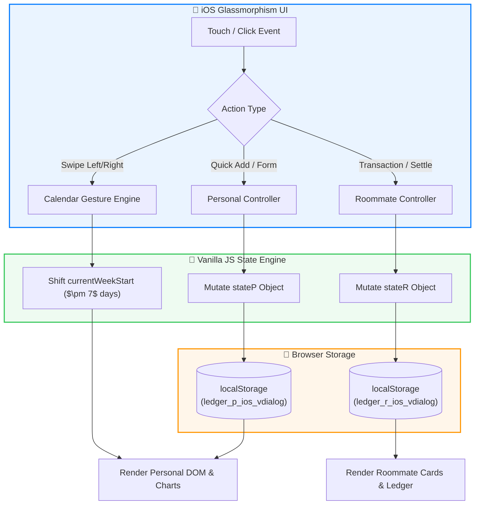
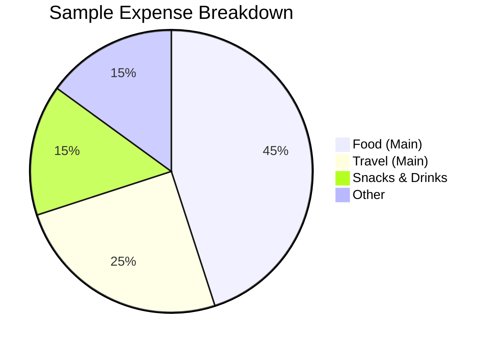

<div align="center">

  <!-- Dynamic SVG Header / Logo -->
  <h1>📊 Ledger <kbd>PRO</kbd></h1>
  
  <p>
    <strong>An Apple-inspired, privacy-first personal finance and shared roommate ledger built with zero dependencies.</strong>
  </p>

  <!-- Shields.io Dynamic Badges -->
  <p>
    
    
    
    
  </p>

  <!-- Quick Jump Anchor Links -->
  <h4>
    <a href="#-overview">Overview</a> •
    <a href="#-key-features">Features</a> •
    <a href="#-system-architecture">Architecture</a> •
    <a href="#-financial-algorithms">Math & Logic</a> •
    <a href="#-design-system">Design System</a> •
    <a href="#-roadmap">Roadmap</a> •
    <a href="#-markdown-masterclass-how-this-file-works">MD Tricks Guide</a>
  </h4>

</div>

---

## 🌟 Overview

**Ledger Pro** is a lightweight, ultra-responsive Progressive Web Application (PWA) candidate engineered inside a single `.html` artifact[^1]. It bridges the gap between **daily personal expense tracking** and **shared roommate bill splitting**, wrapped in an authentic iOS frosted-glass interface (`backdrop-filter: saturate(180%) blur(35px)`).

Unlike bloated cloud-based financial trackers that harvest user data, Ledger Pro operates on a strict **Zero-Knowledge Local Architecture**—your financial footprint never leaves your browser's `localStorage`.

> [!IMPORTANT]
> **Privacy & Data Persistence Notice**
> Because Ledger Pro operates $100\%$ offline within your browser's local sandbox, clearing your browser cache will reset your ledger. Always use the built-in **Backup (JSON)** utility before wiping browser data!

---

## ✨ Key Features

| Module | Feature | Description | Status |
| :--- | :--- | :--- | :---: |
| **Personal** | ⚡ **Quick Log Engine** | One-tap customizable emoji shortcuts for frequent daily expenses. | ✅ |
| **Personal** | 🍩 **Ambient Analytics** | Real-time CSS `conic-gradient` donut charts & stacked glass pill graphs. | ✅ |
| **Personal** | 🗓️ **Gesture Calendar** | Sunday-anchored weekly view with native mobile touch-swipe navigation. | ✅ |
| **Roommates** | 🤝 **IOU Ledger** | Track bidirectional debts (*Owes You* vs. *You Owe*) with instant net balances. | ✅ |
| **Roommates** | 🛡️ **Smart Safeguards** | Context-aware warning dialogs prevent accidental deletion of unsettled roommates. | ✅ |
| **Global** | 🖨️ **Print & Export** | Generate formatted PDF/Print reports by date range, or export raw `.csv` / `.json`. | ✅ |

---

## 🏗️ System Architecture

Markdown supports **Mermaid.js**, allowing us to render complex system diagrams directly from plain text! Here is how Ledger Pro handles state and rendering without external frameworks like React or Vue:



---

## 🧮 Financial Algorithms

Ledger Pro uses LaTeX mathematical formatting to document its internal calculation engines.

### 1. Weekly Budget Utilization
The budget progress bar dynamically shifts colors (Green $\rightarrow$ Orange $\rightarrow$ Red) based on your utilization percentage $U_{\%}$, bounded at $100\%$ for the visual CSS width:

$$U_{\%} = \min\left( \left( \frac{\sum_{i=1}^{n} E_i}{B_{\text{limit}}} \right) \times 100, \ 100 \right)$$

Where:
* $E_i$ represents each individual expense logged within the active Sunday–Saturday window ($0 \le \text{dayIndex} \le 6$).
* $B_{\text{limit}}$ is the user-defined weekly budget threshold.

### 2. Daily Donut Conic Angles
Each category's arc angle $\theta_c$ (in degrees) on the Daily Analytics donut chart is calculated proportionally against total daily spend $T_{\text{day}}$:

$$\theta_c = \left( \frac{C_{\text{total}}}{T_{\text{day}}} \right) \times 360^{\circ}$$

### 3. Roommate Net Balance
For any given roommate $r$, their net standing $B_{\text{net}}(r)$ is evaluated across all historical transactions:

$$B_{\text{net}}(r) = \sum_{t \in \text{add}} A_t - \sum_{t \in \text{remove}} A_t$$

> [!TIP]
> If $B_{\text{net}}(r) > 0$, the UI applies the `.owes-me` class (Green). If $B_{\text{net}}(r) < 0$, it applies `.paid-up` (Red). When $B_{\text{net}}(r) = 0$, the roommate is marked as **Settled Up**.

---

## 🎨 Design System & Interactions

### Dynamic Theme Variables
Ledger Pro seamlessly switches between **Apple Light** and **Apple Dark** modes using CSS Custom Properties. Here is a `diff` block illustrating how the surface tokens transform:

```diff
  /* Light Mode (Default) vs Dark Mode Tokens */
- --bg-color: #F2F2F7;
- --surface: #FFFFFF;
- --primary: #007AFF;
+ --bg-color: #000000;
+ --surface: #1C1C1E;
+ --primary: #0A84FF;
```

### Controls & Hardware Shortcuts
You can navigate Ledger Pro rapidly using hardware inputs and mobile gestures:

* Press <kbd>Esc</kbd> at any time to dismiss the top-most active modal (Dialog $\rightarrow$ Calendar $\rightarrow$ Editor $\rightarrow$ Details).
* Perform a <kbd>Swipe Left</kbd> or <kbd>Swipe Right</kbd> (threshold $> 70\text{px}$) anywhere on the Weekly Calendar card to glide across weeks.
* Click <kbd>Export CSV</kbd> to generate a spreadsheet-ready file with automatic quote-escaping.

<details>
<summary><b>🔍 Click to inspect the underlying JSON Storage Schema</b></summary>
<br>

When you click **Backup**, Ledger Pro serializes your state into the following JSON structure:

```json
{
  "expenses": [
    {
      "id": "1731160000000",
      "date": "2026-11-09",
      "amount": 400.00,
      "category": "food-main",
      "desc": "Lunch"
    }
  ],
  "budget": 5000,
  "quickAdds": [
    {
      "id": "1",
      "emoji": "🍛",
      "label": "Lunch",
      "amount": 400,
      "category": "food-main"
    }
  ]
}
```
</details>

---

## 🗺️ Roadmap

- [x] Core Personal Expense & Roommate Ledger engines
- [x] Custom Portal Dropdowns (breaking out of CSS `z-index` traps)
- [x] Native-style Custom Dialog System (replacing browser `alert()` and `confirm()`)
- [x] Sunday-anchored calendar with mobile touch-swipe gestures
- [ ] **PWA Manifest & Service Worker** (Installable full-screen mobile app)
- [ ] **Haptic Touch Engine** (`navigator.vibrate` feedback on actions)
- [ ] **Smart Bill Splitter** (Divide a single bill across multiple selected roommates automatically)
- [ ] **GitHub-Style Spend Heatmap** (Monthly/Yearly visual activity grid)
- [ ] ~~Cloud Database Sync~~ *(Rejected to preserve $100\%$ local privacy)*

---

<details>
<summary><h2>🎓 Markdown Masterclass: How This File Works (Click to Expand)</h2></summary>

Since you are learning Markdown (`.md`), this entire document was designed as a live showcase of what modern **GitHub Flavored Markdown (GFM)** can achieve! Here is a breakdown of every advanced trick used above:

### 1. Mixing HTML inside Markdown
Standard Markdown cannot center text or create keyboard buttons. However, almost all Markdown parsers allow raw HTML tags!
* **Centered Hero Section:** Used `<div align="center">...</div>` at the very top.
* **Keyboard Keys:** Used `<kbd>Esc</kbd>` to render physical button styles: <kbd>Esc</kbd>.
* **Collapsible Accordions:** Used `<details>` and `<summary>` tags (like the one you just clicked!) to hide long JSON blocks or bonus sections until the user wants to see them.

### 2. GitHub Alerts (Admonitions)
By adding `> [!TYPE]` inside a standard blockquote, modern Markdown renders colorful callout boxes. There are 5 official types:

> [!NOTE]
> Useful information that users should know, even when skimming content.

> [!TIP]
> Helpful advice for doing things better or more easily.

> [!IMPORTANT]
> Key information users need to know to achieve their goal.

> [!WARNING]
> Urgent info that needs immediate user attention to avoid problems.

> [!CAUTION]
> Advises about risks or negative outcomes of certain actions.

### 3. Dynamic Badges (Shields.io)
Those sleek pills at the top aren't static images—they are generated dynamically via URL parameters using `img.shields.io`!
* **Syntax:** `https://img.shields.io/badge/LEFT_TEXT-RIGHT_TEXT-HEX_COLOR?style=for-the-badge&logo=LOGO_NAME`

### 4. Diagrams as Code (Mermaid.js)
By opening a code block with ```` ```mermaid ````, you can write text that compiles into flowcharts, sequence diagrams, pie charts, and timelines!


### 5. LaTeX Mathematical Notation
Enclosing formulas in single `$` renders inline math (e.g., $\theta_c = 360^{\circ}$), while double `$$` renders centered display equations with fractions, summations ($\sum$), and subscripts!

### 6. Diff Syntax Highlighting
By using ```` ```diff ```` on a code block, starting a line with `-` highlights it in **Red** (removed), and starting a line with `+` highlights it in **Green** (added).

### 7. Table Column Alignment
In Markdown tables, the colons (`:`) in the separator row control text alignment:
* `:---` aligns Left
* `:---:` aligns Center
* `---:` aligns Right

### 8. Interactive Task Lists & Footnotes
* `- [x]` creates a checked box, and `- [ ]` creates an unchecked box.
* Adding `[^1]` in text creates a clickable superscript number that jumps to the bottom of the page!

</details>

---

[^1]: **Single-File SPA:** All HTML markup, CSS variables, SVG icons, and Vanilla JavaScript logic are bundled into `index.html` for zero-setup portability.